  

# 🔐 Awesome Identity Provider & SSO Integration

  
  
  
  

  <strong>Curated catalog of enterprise Identity Providers (IdP), Single Sign-On (SSO) systems, SAML 2.0, OpenID Connect (OIDC), OAuth 2.0, and SCIM federation tools for modern cloud architecture and sovereign self-hosted infrastructure.</strong>

  <a href="#-sector-overview--market-dynamics">📈 Sector Overview</a> •
  <a href="#-saas--hosted-identity-platforms">☁️ SaaS Platforms</a> •
  <a href="#-open-source-github-projects">💻 Open-Source Projects</a> •
  <a href="#-architectural-patterns--middleware">🏗️ Architecture</a> •
  <a href="#-star-history">⭐ Star History</a> •
  <a href="#-support--sponsorship">💖 Support</a>

---

## 📈 Sector Overview & Market Dynamics

The global **Identity and Access Management (IAM)** market is valued at approximately **$24.3 billion to $29.7 billion in 2026** (growing at an estimated 11% to 17% CAGR toward $60B+ by the early 2030s). Structurally, the sector exhibits **moderate concentration at the top**—dominated by hyper-scale enterprise ecosystem anchors like Microsoft, AWS, Cisco, and pure-play identity leaders Okta and CyberArk—alongside **high fragmentation in specialized sub-domains** (such as developer-first CIAM, customer federation, privileged access management, and cloud-native self-hosted architectures).

---

## 📑 Table of Contents

- [📈 Sector Overview & Market Dynamics](#-sector-overview--market-dynamics)
- [☁️ SaaS & Hosted Identity Platforms](#-saas--hosted-identity-platforms)
- [💻 Open-Source GitHub Projects](#-open-source-github-projects)
- [🏗️ Architectural Patterns & Middleware](#-architectural-patterns--middleware)
- [⭐ Star History](#-star-history)
- [💖 Support & Sponsorship](#-support--sponsorship)
- [🤝 How to Contribute](#-how-to-contribute)
- [⚠️ Disclaimer](#️-disclaimer)

---

## ☁️ SaaS & Hosted Identity Platforms

| Product / Platform | Company Valuation / Revenue | Starting Pricing | Free Tier / Free Trial Limits | Key SSO & IAM Capabilities |
| :--- | :--- | :--- | :--- | :--- |
| **[Microsoft Entra Application Gallery](https://www.microsoft.com/en-us/security/business/identity-access/microsoft-entra-id)** | 🏢 Market Cap: ~$3.1T (Microsoft Corp) / FY25 Rev: ~$245B | 💵 **$7.00** per user/month (Entra ID P1, billed annually) | 🎁 **Free forever**: Included with Azure/M365 accounts; soft quota limit up to 50,000 directory objects, basic cloud authentication, SSO, and tenant-wide security defaults | 🛡️ Cloud identity ecosystem providing seamless enterprise SSO, Conditional Access, and automated SCIM provisioning across thousands of SaaS applications. |
| **[AWS IAM Identity Center Integrations](https://aws.amazon.com/iam/identity-center/)** | 🏢 Market Cap: ~$2.1T (Amazon.com) / FY25 Rev: ~$620B | 💵 **$0.00** (Permanently $0 for core IAM Identity Center service) | 🎁 **Free forever**: Full access with no per-user fees or application limits; charges apply only to external connected resources (e.g., AWS Managed Microsoft AD) | 🛡️ Centralized workforce identity and SSO portal managing access across multi-account AWS environments and SAML 2.0 cloud business apps. |
| **[Cisco Duo Applications](https://duo.com)** | 🏢 Market Cap: ~$230B (Cisco Systems) / FY25 Rev: ~$53.8B | 💵 **$3.00** per user/month (Duo Essentials, billed annually) | 🎁 **Free forever**: Up to 10 users with Duo Free; includes basic multi-factor authentication (MFA) and Duo Mobile credentials | 🛡️ Zero-trust authentication platform offering single sign-on integrations paired with phishing-resistant MFA and device security health checks. |
| **[Okta Integration Network (OIN)](https://www.okta.com)** | 🏢 Market Cap: ~$32.5B (Okta, Inc.) / FY25 Rev: ~$2.91B | 💵 **$6.00** per user/month (Workforce Starter Suite, billed annually) | ⏳ **30-day free trial**: Full access to cloud directory, pre-built app integrations, and MFA workflows (standard paid tiers carry ~$1,500/year contract minimum) | 🛡️ Enterprise identity standard offering thousands of pre-configured SAML 2.0, OIDC, and SCIM connectors for cloud and hybrid workloads. |
| **[CyberArk App Catalog](https://www.cyberark.com)** | 🏢 Valuation: $25B (Acquired by Palo Alto Networks) / FY25 Rev: ~$1.36B | 💵 **$4.00** per user/month (Workforce Identity entry tier, billed annually) | ⏳ **14-day free trial**: Virtual lab/PoC tenant evaluation with SSO, app gateway access, and adaptive MFA policies | 🛡️ Privileged-centric identity security platform offering hardened SSO integrations with adaptive risk-based authentication and credential isolation. |
| **[Auth0 Marketplace](https://auth0.com)** | 🏢 Valuation: ~$6.5B (Okta subsidiary) / Included in Okta Revenue | 💵 **$35.00** per month (Essentials B2B tier starting base) | 🎁 **Free forever**: Up to 25,000 Monthly Active Users (MAU), 5 Organizations, and 1 Enterprise SSO Connection (SAML/OIDC/Entra ID) with self-service admin SSO | 🛡️ Developer-first CIAM and B2B identity platform offering plug-and-play social logins, enterprise federation actions, and custom token pipelines. |
| **[BrowserStack SSO Integration](https://www.browserstack.com)** | 🏢 Valuation: ~$4.0B / FY25 Rev: ~$230M | 💵 **$29.00** per user/month (Live Desktop starting tier; Enterprise SSO via custom sales quote) | ⏳ **Free trial**: 30 minutes of live manual cross-browser testing and 100 automated minutes; dedicated enterprise SSO PoC available upon sales request | 🛡️ Enterprise SAML 2.0 single sign-on integration providing unified developer authentication and access control across cross-browser testing suites. |
| **[Ping Identity Integration Directory](https://www.pingidentity.com)** | 🏢 Valuation: ~$2.8B (Acquired by Thoma Bravo) / Est. Rev: ~$350M+ | 💵 **$3.00** per user/month (PingOne Essential; requires enterprise contract minimum) | ⏳ **30-day free trial**: Sandbox environment supporting up to 1,000 active identities in the PingOne administration portal | 🛡️ Enterprise hybrid IAM directory offering federated SAML, OAuth 2.0, and OIDC connectors designed for complex distributed IT topologies. |
| **[JumpCloud Directory Integrations](https://jumpcloud.com)** | 🏢 Valuation: ~$2.6B / Est. ARR: ~$150M–$200M | 💵 **$11.00** per user/month (SSO Package, billed annually) | ⏳ **30-day free trial**: Complete platform evaluation with full access to SSO, device management, and directory sync features | 🛡️ Cloud directory and MDM platform unifying workstation management with SAML 2.0, OIDC, SCIM, and cloud LDAP single sign-on. |
| **[OneLogin App Catalog](https://www.onelogin.com)** | 🏢 Valuation: ~$330M (One Identity / Quest Software, Clearlake Capital) / Est. Rev: ~$70M | 💵 **$4.00** per user/month (OneLogin Workforce entry plan) | ⏳ **30-day free trial**: No credit card required; full access to cloud directory sync, desktop/mobile SSO connectors, and MFA | 🛡️ Comprehensive identity management suite featuring thousands of turnkey SAML/OIDC connectors and automated lifecycle management. |

---

## 💻 Open-Source GitHub Projects

> Sorted by GitHub stargazer count (descending). Each badge links directly to the project's official stargazer community page.

| Project | Stars | Focus & Protocols | Description |
| :--- | :--- | :--- | :--- |
| **[Keycloak](https://github.com/keycloak/keycloak)** |  | 🔑 SAML 2.0, OIDC, OAuth 2.0, SCIM, LDAP/AD | ⚙️ Industry-standard open-source Identity and Access Management solution developed by Red Hat, providing full SSO, identity brokering, and fine-grained authorization. |
| **[Authelia](https://github.com/authelia/authelia)** |  | 🛡️ OIDC, Forward Auth, 2FA, Duo, FIDO2 | ⚙️ Lightweight authentication and authorization server providing 2FA and single sign-on for reverse proxies including Nginx, Traefik, Caddy, and Envoy. |
| **[Authentik](https://github.com/goauthentik/authentik)** |  | 🔄 SAML 2.0, OIDC, OAuth2, LDAP, SCIM, Radius | ⚙️ Versatile identity provider featuring an intuitive flow designer, outpost reverse-proxies, user directory federation, and built-in enterprise SAML/OIDC app catalog. |
| **[Ory Hydra](https://github.com/ory/hydra)** |  | ⚡ OAuth 2.1, OIDC Certified, Headless | ⚙️ Cloud-native, high-throughput OpenID Connect certified provider and OAuth 2.0 authorization engine designed for microservice architectures. |
| **[ZITADEL](https://github.com/zitadel/zitadel)** |  | 🏢 OIDC, OAuth2, SAML 2.0, Passkeys, Multi-Tenant | ⚙️ Cloud-native identity infrastructure built in Go, offering turn-key multi-tenancy, self-hosted branding, audit trails, and WebAuthn passwordless authentication. |
| **[OAuth2 Proxy](https://github.com/oauth2-proxy/oauth2-proxy)** |  | 🌐 OIDC, OAuth2, Upstream Reverse Proxy | ⚙️ Reverse proxy that protects downstream web services by requiring authentication through standard identity providers like Google, GitHub, Okta, or Keycloak. |
| **[SuperTokens](https://github.com/supertokens/supertokens-core)** |  | 🧩 Enterprise SSO, SAML, Social Login, Session Mgmt | ⚙️ Developer-focused authentication and session management architecture with pre-built UI components and SAML integrations as an Auth0/Firebase alternative. |
| **[Logto](https://github.com/logto-io/logto)** |  | 🚀 OIDC, OAuth2, Enterprise SSO, RBAC | ⚙️ Modern open-source identity platform tailored for multi-tenant SaaS applications with out-of-the-box support for enterprise SAML and OIDC connections. |
| **[Casdoor](https://github.com/casdoor/casdoor)** |  | 🚪 OAuth 2.0, OIDC, SAML 2.0, CAS, RADIUS, LDAP | ⚙️ UI-driven Identity and Access Management (IAM) and single sign-on platform written in Go/React with support for extensive identity federation providers. |
| **[Ory Kratos](https://github.com/ory/kratos)** |  | 👤 Headless Identity, OIDC Brokering, MFA | ⚙️ API-first user management, self-service registration, profile administration, and multi-factor authentication engine engineered for zero-trust architectures. |
| **[Apereo CAS](https://github.com/apereo/cas)** |  | 🏛️ CAS 1/2/3, SAML 2.0, OpenID Connect, WS-FED | ⚙️ Enterprise-grade, battle-tested single sign-on engine widely implemented across higher-education institutions and large-scale enterprises globally. |
| **[Dex](https://github.com/dexidp/dex)** |  | 🔌 OIDC, SAML Brokering, LDAP, OAuth2 | ⚙️ Pluggable OpenID Connect identity provider that acts as a federation portal to authenticate against LDAP, SAML, GitHub, and external IdP directories. |
| **[Hanko](https://github.com/teamhanko/hanko)** |  | 👆 Passkeys, FIDO2, WebAuthn, OIDC | ⚙️ Lightweight, passkey-first authentication suite and user management API engineered to replace traditional passwords with biometric authentication. |
| **[LLDAP](https://github.com/lldap/lldap)** |  | 📇 Lightweight LDAP, SQLite, User Management | ⚙️ Simplified, low-footprint authentication server providing an opinionated LDAP directory interface ideal for pairing with Authelia or Authentik SSO setups. |
| **[Kanidm](https://github.com/kanidm/kanidm)** |  | 🦀 OAuth2, OIDC, RADIUS, LDAP, SSH Keys | ⚙️ Fast, memory-safe identity management platform implemented in Rust, purpose-built for enterprise access control and modern server management. |
| **[Pomerium](https://github.com/pomerium/pomerium)** |  | 🧭 Identity-Aware Proxy, BeyondCorp, OIDC | ⚙️ Context-aware reverse proxy that intercepts network traffic to enforce zero-trust authentication and access policies without requiring a client VPN. |
| **[Supabase Auth (GoTrue)](https://github.com/supabase/auth)** |  | ⚡ JWT, SAML 2.0, OAuth2, Enterprise SSO | ⚙️ Multi-tenant Go authentication service powering Supabase, offering robust SAML 2.0 SSO identity provider connectors and token management. |
| **[PrivacyIDEA](https://github.com/privacyidea/privacyidea)** |  | 🔒 2FA, MFA, OTP, FIDO2, SAML/OIDC Plugins | ⚙️ Modular multi-factor authentication system supporting OTP tokens, smartcards, push tokens, and integration into existing IdP stacks. |
| **[FreeIPA](https://github.com/freeipa/freeipa)** |  | 🐧 Kerberos, 389 Directory Server, DNS, PKI | ⚙️ Integrated Linux enterprise identity and security management solution providing centralized domain control, trust federation, and host access control. |
| **[SimpleSAMLphp](https://github.com/simplesamlphp/simplesamlphp)** |  | 🐘 SAML 2.0 IdP & SP, WS-Federation, OIDC | ⚙️ Award-winning PHP application engineered to function as both a robust SAML 2.0 Identity Provider and Service Provider for cross-organization federation. |
| **[WSO2 Identity Server](https://github.com/wso2/product-is)** |  | 🏢 SAML, OIDC, SCIM 2.0, XACML, WS-Federation | ⚙️ Enterprise identity and access management server supporting complex identity federation, entitlement management, and automated provisioning flows. |
| **[Janssen Project (Gluu)](https://github.com/JanssenProject/jans)** |  | 🐧 OAuth 2.0, OIDC, FIDO2, Agama Low-Code | ⚙️ High-performance open-source IAM engine under the Linux Foundation designed for sovereign cloud deployments and low-code authentication journeys. |
| **[OpenUnison](https://github.com/TremoloSecurity/OpenUnison)** |  | ☸️ Kubernetes SSO, OIDC, Reverse Proxy | ⚙️ Cloud-native identity portal purpose-built for Kubernetes clusters, providing enterprise SSO, RBAC synchronization, and multi-cluster access proxying. |
| **[Gravitee Access Management](https://github.com/gravitee-io/gravitee-access-management)** |  | 🛡️ OAuth2, OIDC, SCIM, Biometrics, API Security | ⚙️ Comprehensive API-centric IAM solution delivering centralized single sign-on, identity brokering, and multi-factor authorization protection. |

---

## 🏗️ Architectural Patterns & Middleware

- 🌐 **Federated SSO Hubs**: Pair **Keycloak** or **Authentik** as primary Identity Providers (IdPs) with upstream identity federation to Google Workspace, GitHub, and corporate Active Directory.
- 🚦 **Reverse Proxy Gateways**: Combine **OAuth2 Proxy** or **Authelia** with modern edge proxies (**Traefik**, **Caddy**, **Nginx**, **Envoy**) to inject verified headers (`Remote-User`, `X-Forwarded-Email`) into internal microservices.
- 🔄 **Enterprise Provisioning (SCIM 2.0)**: Automate end-to-end user lifecycle management, employee offboarding, and group-membership mapping across distributed SaaS tools and self-hosted instances.
- 🔑 **Passwordless Zero-Trust**: Implement **FIDO2 / WebAuthn passkeys** with **Hanko** or **ZITADEL** to eliminate credential stuffing attacks.

---

## ⭐ Star History

---

## 💖 Support & Sponsorship

Thank you so much for exploring and using this repository! Maintaining and curating high-quality open-source and identity architectures takes dedicated effort and continuous research.

If you find this project valuable, here are a few wonderful ways you can support it:
- ⭐ **Star the repo** to help others discover it across GitHub.
- 🍴 **Fork and contribute** by submitting PRs with missing identity tools or updated protocols.
- 📢 **Share with your team**, on LinkedIn, Twitter/X, or your favorite tech Discord/Slack communities.
- ☕ **Buy me a coffee or sponsor ongoing development**: Support via the [GitHub Sponsors Dashboard](https://github.com/sponsors/ishandutta2007). Every bit of support is deeply appreciated!

---

## 🤝 How to Contribute

1. 🍴 Fork the repository.
2. 📝 Add or update entries in `README.md` keeping the tabular structure.
3. ☁️ For SaaS platforms: include specific starting tier price, verified free tier limits, and corporate valuation/revenue.
4. 💻 For Open-Source projects: include repo link, star badge formatted as ``, protocols, and description.
5. 🚀 Submit a pull request with a concise overview of the changes.

---

## ⚠️ Disclaimer

- 📖 This curated list is maintained for educational and architectural reference purposes.
- 🛡️ Identity and single sign-on systems require adherence to rigorous security governance standards (SOC 2, ISO 27001, HIPAA, GDPR, FedRAMP).
- 🔐 Self-hosted identity providers require proper cryptographic hardening, high availability clustering, and automated key rotation policies.

---

  Maintained with ❤️ for Security Engineers, Identity Architects, DevOps Teams, and Cloud Infrastructure Engineers.

